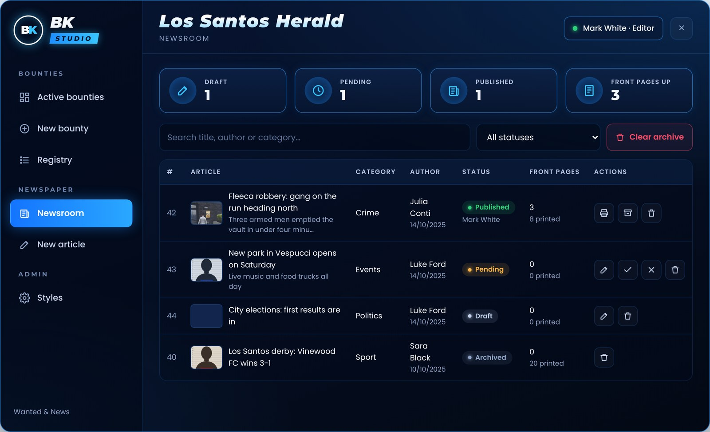
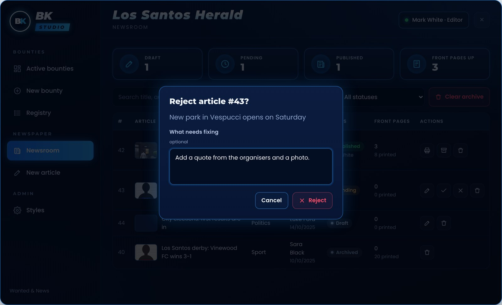

# Editor approval

<figure><figcaption>
The newsroom: drafts, pending, published, archived
</figcaption></figure>

Editors (grade ≥ `editor` in `Config.News.Jobs`) see every article.

| Status | What editors can do |
| --- | --- |
| **Pending** | ✓ approve and publish · ✕ reject with a note · edit |
| **Draft** | edit · delete |
| **Published** | print · archive · delete |
| **Archived** | delete |

## Rejecting

<figure><figcaption>
Rejecting with a note for the reporter
</figcaption></figure>

The article goes back to drafts and the reporter sees the note at the top of the editor.

## Archive

Archiving stops printing and (with `RemoveOnClose`) takes its front pages off the walls. **Clear archive** deletes every archived article; `Config.HistoryDays` does it automatically.
