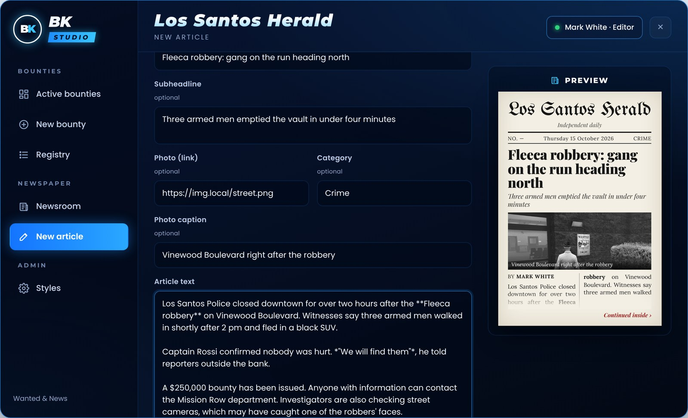
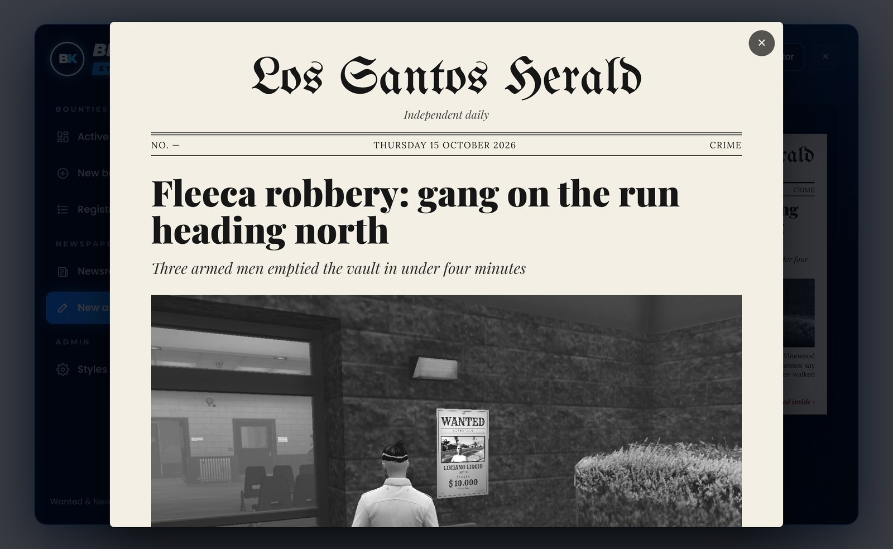

# Writing articles

Open the **newsroom** point and go to **New article**.

<figure><figcaption>
The article editor with front-page preview
</figcaption></figure>

| Field | |
| --- | --- |
| Headline | up to 120 characters |
| Subheadline | optional |
| Photo + caption | optional, from an allowed link |
| Category | optional, suggestions from the language file |
| Article text | up to 8000 characters |

## Formatting

| Write | Get |
| --- | --- |
| `**text**` | **bold** |
| `*text*` | *italic* |
| empty line | new paragraph |

**Read** opens the full article as players will see it.

<figure><figcaption>
Reading the full article
</figcaption></figure>

## Save or send

* **Save draft** — only you (and editors) see it.
* **Send to editor** — goes to approval. Editors (or everyone, with `Approval = false`) see **Publish** instead.

Published articles can't be edited anymore.
