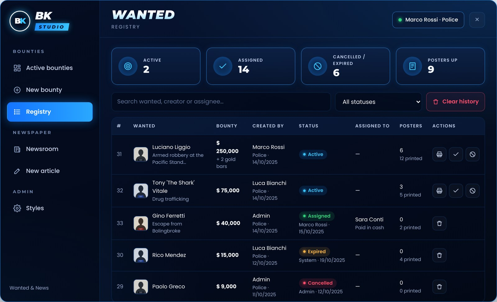

# Registry and history

<figure><figcaption>
The registry with filters and history
</figcaption></figure>

The registry lists every bounty: who created it and when, status, who received it and the notes, how many posters were printed and stuck.

* **Search** by wanted person, creator or assignee.
* **Filter** by status: Active, Assigned, Cancelled, Expired.
* Click a row to open the poster.

## Cleaning up

| Action | |
| --- | --- |
| 🗑 on a closed row | deletes that bounty forever |
| **Clear history** | deletes every closed bounty (active ones stay) |
| `Config.HistoryDays` | deletes closed bounties automatically after X days |

Active bounties can't be deleted: cancel or assign them first.
